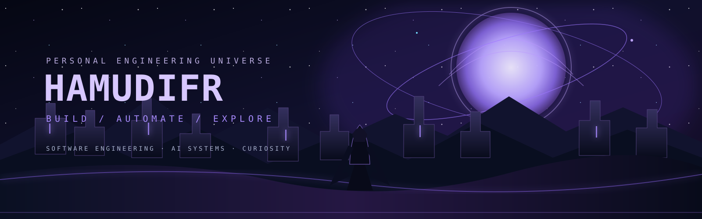

<code>BUILD • LEARN • ITERATE</code>

# Hey, I'm Hamudifr.

I'm a student developer interested in how software works beneath the surface. I learn by building, testing ideas, and turning small experiments into useful systems.

### Current direction

- **Software engineering** — writing practical, maintainable code
- **Automation** — making repetitive work simpler and more reliable
- **AI systems** — exploring useful tools, agents, and intelligent workflows

### Tools I work with

`Python` · `Rust` · `SQL` · `Git`

### A small philosophy

> Stay curious. Build deliberately. Verify what works.

  
  

---

Designed with a quiet midnight palette and a little cyan signal. No noise, just progress.
